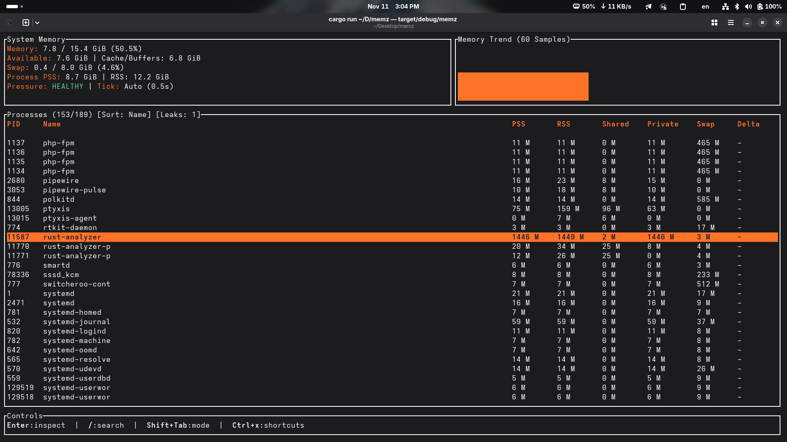
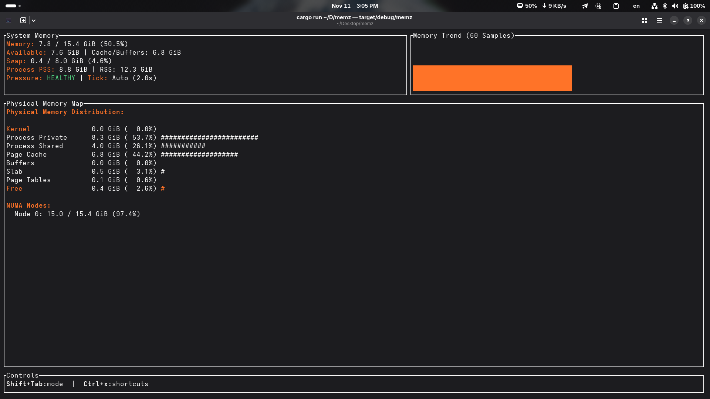
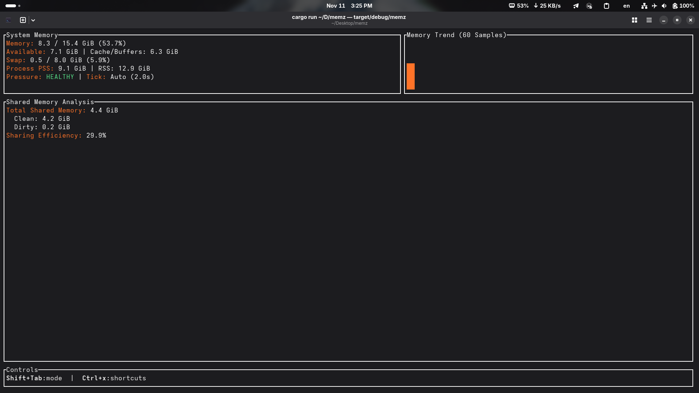

# MEMZ

A fast, cross-platform terminal memory profiler and leak detector written in Rust.

Most system monitors rely on Resident Set Size (RSS), which counts shared libraries multiple times and makes overall memory usage look much higher than it actually is. `memz` uses Proportional Set Size (PSS) from Linux procfs to report accurate, proportional memory numbers. It also tracks process growth history, runs running linear regression to flag memory leaks in real time, and dynamically dials back its own polling rate when your system is idle.

---

## Screenshots

### Processes View


### Physical Memory Map


### Shared Memory Analysis


---

## Installation

### Option 1: Download Pre-built Binaries (Recommended)

You can grab the latest compiled binary directly from the [GitHub Releases](https://github.com/naseridev/memz/releases) page:

1. Head over to the Releases section and choose the archive matching your operating system and CPU architecture (Linux, macOS, or Windows).
2. Download and unpack the archive:
   ```bash
   tar -xzf memz-linux-x86_64.tar.gz
   chmod +x memz
   ```
3. Move the binary into your system path (optional):
   ```bash
   sudo mv memz /usr/local/bin/
   ```

### Option 2: Build from Source

If you prefer building from source, make sure you have Rust 1.74 or later installed:

```bash
git clone https://github.com/naseridev/memz.git
cd memz
cargo build --release
```

The resulting binary will be saved under `target/release/memz`.

### Running the Profiler

On Linux, reading memory maps for processes owned by other users requires elevated privileges:

```bash
# Linux (recommended for full system visibility)
sudo ./memz

# macOS and Windows
./memz
```

---

## What It Does

- **Real PSS Accounting**: Reads `/proc/[pid]/smaps_rollup` to divide shared libraries equally among sharing processes, giving you realistic memory numbers that actually sum up to your total used RAM.
- **Automated Leak Detection**: Fits an ordinary least squares regression line over a rolling window of recent samples. If a process shows persistent positive growth without garbage collection or release cycles, `memz` flags it with a red `[LEAK?]` label.
- **Kernel PSI Pressure Tracking**: Reads `/proc/pressure/memory` to show whether the system is healthy, entering reclaim pressure, or actively swapping.
- **Adaptive Polling Intervals**:
  - `Eco (2.0s)`: Saves CPU cycles when memory is stable and pressure is low.
  - `Normal (1.0s)`: Engaged when opening deep inspect modals.
  - `Fast (0.5s)`: Triggered automatically when thrashing, high PSI stalls, or active leaks occur.
  - Adjust manual speeds any time using `+` and `-`.
- **Differential Snapshot Baselines**: Tap `b` at any point to save a baseline. Columns immediately switch to displaying relative growth ($\Delta$) since that snapshot, making it easy to benchmark a specific command or workload.
- **Process Grouping**: Tap `g` to combine multi-process programs (such as Chrome, Firefox, or PostgreSQL workers) into a single row with unified totals.
- **On-Demand Memory Inspector**: Press `Enter` on any process or group to inspect its breakdown across heap, stack, anonymous mappings, and shared libraries.
- **Session Memory**: Remembers your preferred accent color, default view, sorting order, and grouping preferences between runs.

---

## How the Math Works

### PSS vs RSS

Traditional tools sum Resident Set Size (RSS), where every process claims full ownership of shared code:

$$\text{RSS}_{\text{total}} = \sum_{i=1}^{M} \text{Pages}(P_i)$$

PSS divides shared pages by the count of processes ($N$) sharing that physical frame:

$$\text{PSS} = \text{Private Pages} + \sum_{j=1}^{S} \frac{\text{Shared Page}_j}{N_j}$$

When you sum PSS across every process on the machine, the result closely matches the physical RAM currently occupied by user processes:

$$\sum_{i=1}^{M} \text{PSS}_i \approx \text{Physical RAM in Use}$$

### Statistical Leak Detection

Instead of reacting to single allocation spikes, `memz` looks at rolling history buffers ($n \ge 8$) and computes an ordinary least squares regression slope:

$$\bar{t} = \frac{1}{n}\sum_{i=1}^{n} t_i, \quad \bar{y} = \frac{1}{n}\sum_{i=1}^{n} \text{PSS}_i$$

The sample slope $m$ and correlation quality $R^2$ are calculated as:

$$m = \frac{\sum_{i=1}^{n} (t_i - \bar{t})(\text{PSS}_i - \bar{y})}{\sum_{i=1}^{n} (t_i - \bar{t})^2}$$

$$R^2 = \frac{\left[\sum_{i=1}^{n} (t_i - \bar{t})(\text{PSS}_i - \bar{y})\right]^2}{\sum_{i=1}^{n} (t_i - \bar{t})^2 \cdot \sum_{i=1}^{n} (\text{PSS}_i - \bar{y})^2}$$

Because sampling intervals can change, the growth rate is normalized by the real elapsed time ($\Delta t$):

$$\text{Rate} = \frac{m}{\Delta t} \quad [\text{KB/s}]$$

A process gets marked with `[LEAK?]` when:
1. It has at least 8 consecutive samples.
2. The normalized growth rate is at least $32\text{ KB/s}$.
3. The fit linearity $R^2$ is $0.70$ or higher.
4. Temporary drops do not exceed one third of total observed growth.

---

## Keyboard and Mouse Shortcuts

### Main Controls

| Key / Input | Context | What It Does |
| :--- | :--- | :--- |
| `Enter` | Processes | Open process breakdown inspector |
| `/` | Processes | Filter rows by process name or PID |
| `Shift + Tab` | Global | Cycle views (Processes $\to$ Memory Map $\to$ Shared Memory) |
| `Ctrl + x` | Global | Open the scrollable command palette |
| `Up` / `Down` | Tables / Menus | Move the active selection cursor |
| `PgUp` / `PgDn` | Table | Jump by one visible page |
| `Scroll Wheel` | Tables / Menus | Scroll content up or down |
| `Left Click` | Table Header | Sort rows by clicked column |
| `Left Click` | Row | Select process or open inspector |
| `Right Click` | Modals / Row | Dismiss popup or inspect row under cursor |
| `Esc` | Modals / Search | Exit prompt, clear filter, or close modal |

### Quick Keys

These single keys work directly in normal mode without opening `Ctrl + x`:

| Key | What It Does |
| :--- | :--- |
| `g` | Toggle process grouping |
| `b` | Save or clear relative baseline snapshot |
| `n` | Cycle through sort columns (PSS, RSS, Shared, Private, Swap, Delta, PID, Name) |
| `k` | Terminate selected process (SIGTERM) |
| `c` | Open the 8-color theme picker |
| `+` / `=` | Increase polling rate |
| `-` / `_` | Decrease polling rate |
| `q` | Exit memz |

---

## Saved Settings

Settings are stored in a plain text configuration file on exit:

- **Linux and macOS**: `$XDG_CONFIG_HOME/memz/state.conf` (defaults to `~/.config/memz/state.conf`)
- **Windows**: `%APPDATA%\memz\state.conf`

Sample configuration:
```ini
theme=ember_orange
view_mode=processes
sort_mode=pss
tick_mode=auto
grouped=false
```

---

## Technical Documentation

If you want to read about the threading model, lockless communication channels, kernel procfs details, or benchmark numbers, check out the [Technical Wiki](README.wiki.md).

## License

Published under the MIT License. See [LICENSE](LICENSE) for details.